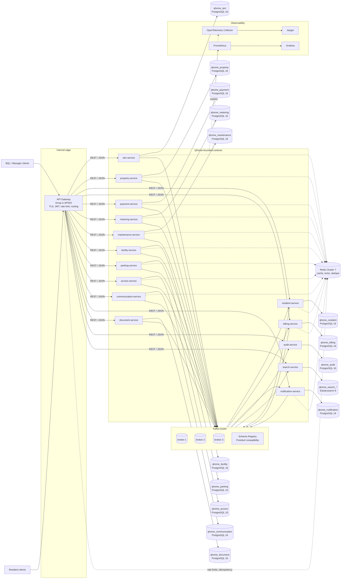
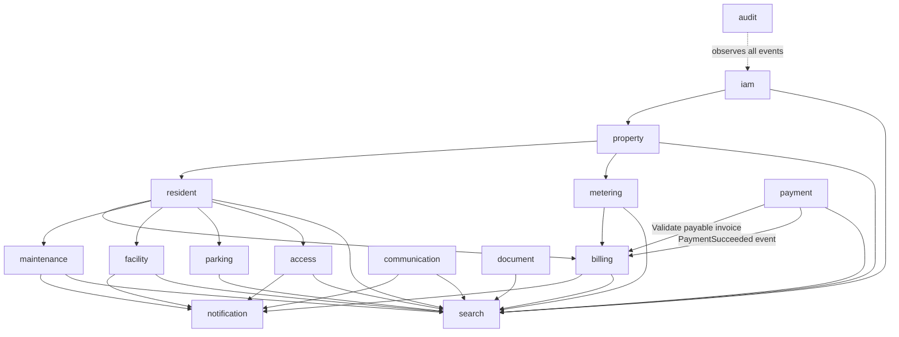

# QHome PMS and Resident Backend Architecture

Status: proposed

## 1. Architectural shape

The system is split by business ownership, not by technical CRUD tables. Each service owns one PostgreSQL database, its migrations, its transaction boundaries, and its outbox. Other services retain only foreign identifiers and event-derived snapshots. No service reads another service's database.

The Gateway is the only Internet entry point. It terminates TLS, verifies JWTs, applies rate limits, generates or validates `x-correlation-id`, derives the authorized `x-tenant-id` and optional `x-apartment-id` from the token and membership data, then forwards the request. A client-supplied tenant or apartment header is never trusted as authorization input.

`Redis Cluster` is never the source of truth for billing, occupancy, access, or booking. The search service is the only owner of the Elasticsearch indexes. PostgreSQL databases may run on a shared HA cluster initially, but each database has a separate role, migration history, network policy, and backup/restore boundary.

## 2. Gateway routing and request context

| Route prefix | Upstream | Main callers |
|---|---|---|
| `/v1/auth`, `/v1/me`, `/v1/iam` | `iam-service` | BQL, resident |
| `/v1/properties`, `/v1/buildings`, `/v1/apartments` | `property-service` | BQL, resident read |
| `/v1/residents`, `/v1/households`, `/v1/occupancies` | `resident-service` | BQL, resident |
| `/v1/invoices`, `/v1/charges`, `/v1/balances`, `/v1/ledger` | `billing-service` | BQL, resident |
| `/v1/payment-intents`, `/v1/payments` | `payment-service` | BQL, resident |
| `/v1/meters`, `/v1/readings`, `/v1/utility-bills` | `metering-service` | BQL, resident |
| `/v1/service-requests`, `/v1/work-orders`, `/v1/vendors` | `maintenance-service` | BQL, resident |
| `/v1/amenities`, `/v1/bookings` | `facility-service` | BQL, resident |
| `/v1/vehicles`, `/v1/parking-slots`, `/v1/parking-assignments` | `parking-service` | BQL, resident |
| `/v1/visitor-passes`, `/v1/access-cards`, `/v1/incidents` | `access-service` | BQL, resident |
| `/v1/announcements`, `/v1/announcement-campaigns` | `communication-service` | BQL, resident read |
| `/v1/notifications`, `/v1/notification-preferences` | `notification-service` | BQL, resident |
| `/v1/documents`, `/v1/document-links` | `document-service` | BQL, resident |
| `/v1/audit-events` | `audit-service` | BQL, compliance |
| `/v1/search`, `/v1/dashboards` | `search-service` | BQL, resident |

Gateway policy:

- Verify JWT signature, expiry, issuer, audience, and required scopes.
- Resolve the selected membership and overwrite `x-tenant-id` with the authorized tenant ID. Reject a conflicting client value.
- Require `x-apartment-id` for resident operations and verify that it belongs to the authenticated resident's active occupancy. BQL operations omit it or use an explicitly authorized apartment scope.
- Generate a correlation ID when absent, reject malformed or duplicated values, and propagate it to HTTP, gRPC metadata, Kafka headers, and logs.
- Forward `x-actor-id`, `x-scopes`, and `x-client-type` as gateway-authenticated context. Services still perform resource-level authorization; gateway verification is not a substitute for service authorization.
- Apply route-specific quotas and an `Idempotency-Key` requirement to payment, booking, access-pass, and other commands that can be retried.

Every service exposes an OpenAPI 3.1 document. Use cursor pagination, `application/problem+json` error envelopes, RFC 3339 timestamps, integer minor units for money, and explicit command/read routes. Do not expose database models directly.

## 3. Bounded Context Matrix

`REST` lists the public API surface behind the Gateway. `gRPC` lists internal contracts; the caller is shown in parentheses when the direction matters. Topic names are versioned envelopes, with event types registered in the schema registry.

| Service | Owned data and database | Public REST | Internal gRPC | Published topics | Subscribed topics |
|---|---|---|---|---|---|
| `iam-service` | Users, credentials, roles, memberships, refresh-token state; `qhome_iam` | `/v1/auth/*`, `/v1/me`, `/v1/iam/memberships` | `ResolvePrincipal`, `GetMembership`, `CheckScope` | `qhome.iam.events.v1`: `UserRegistered`, `MembershipGranted`, `MembershipRevoked`, `RoleChanged` | None for domain state |
| `property-service` | Tenants, properties, buildings, apartments, shared facilities; `qhome_property` | `/v1/properties`, `/v1/buildings`, `/v1/apartments` | `GetApartment`, `GetTenant`, `CheckTenantScope` | `qhome.property.events.v1`: `TenantCreated`, `ApartmentCreated`, `ApartmentDeactivated`, `FacilityChanged` | None for domain state |
| `resident-service` | Residents, households, occupancy history, emergency contacts; `qhome_resident` | `/v1/residents`, `/v1/households`, `/v1/occupancies` | `GetResidentSnapshot`, `GetOccupancy`, `ListApartmentResidents` | `qhome.resident.events.v1`: `ResidentRegistered`, `OccupancyStarted`, `OccupancyEnded`, `ResidentMoved` | `iam.events`, `property.events` |
| `billing-service` | Charges, invoices, balances, ledger entries, adjustments; `qhome_billing` | `/v1/invoices`, `/v1/charges`, `/v1/balances`, `/v1/ledger` | `GetPayableInvoice` (payment), `GetBalance` | `qhome.billing.events.v1`: `InvoiceIssued`, `InvoiceOverdue`, `LedgerPosted`, `BalanceChanged` | `resident.events`, `property.events`, `metering.events`, `payment.events` |
| `payment-service` | Payment intents, provider attempts, refunds, provider callbacks; `qhome_payment` | `/v1/payment-intents`, `/v1/payments`, `/v1/refunds` | `GetPayment`, `CreatePaymentIntent` | `qhome.payment.events.v1`: `PaymentInitiated`, `PaymentSucceeded`, `PaymentFailed`, `Refunded` | None; calls `billing.GetPayableInvoice` with a deadline |
| `metering-service` | Meters, readings, validation results, utility calculations; `qhome_metering` | `/v1/meters`, `/v1/readings`, `/v1/utility-bills` | `GetMeter`, `GetLatestReading` | `qhome.metering.events.v1`: `ReadingAccepted`, `UtilityChargeCalculated` | `property.events`, `resident.events` |
| `maintenance-service` | Service requests, work orders, assignments, vendors, SLA state; `qhome_maintenance` | `/v1/service-requests`, `/v1/work-orders`, `/v1/vendors` | `GetWorkOrder`, `GetRequestStatus` | `qhome.maintenance.events.v1`: `ServiceRequestCreated`, `WorkOrderAssigned`, `WorkOrderCompleted` | `property.events`, `resident.events` |
| `facility-service` | Amenities, availability rules, bookings, cancellation policy; `qhome_facility` | `/v1/amenities`, `/v1/bookings` | `CheckAvailability`, `GetBooking` | `qhome.facility.events.v1`: `BookingCreated`, `BookingCancelled`, `BookingCompleted` | `property.events`, `resident.events` |
| `parking-service` | Vehicles, parking slots, assignments, violations; `qhome_parking` | `/v1/vehicles`, `/v1/parking-slots`, `/v1/parking-assignments` | `GetParkingAssignment`, `CheckVehicle` | `qhome.parking.events.v1`: `VehicleRegistered`, `ParkingAssigned`, `ParkingReleased` | `property.events`, `resident.events` |
| `access-service` | Access cards, visitor passes, access policies, incidents; `qhome_access` | `/v1/visitor-passes`, `/v1/access-cards`, `/v1/incidents` | `ValidateVisitorPass`, `CheckAccessPolicy` | `qhome.access.events.v1`: `VisitorPassIssued`, `VisitorPassRevoked`, `IncidentRecorded` | `property.events`, `resident.events`, `parking.events` |
| `communication-service` | Announcements, audience rules, publication schedule; `qhome_communication` | `/v1/announcements`, `/v1/announcement-campaigns` | `ResolveAudience`, `GetAnnouncement` | `qhome.communication.events.v1`: `AnnouncementPublished`, `AnnouncementRetracted` | `property.events`, `resident.events` |
| `notification-service` | Recipient inbox, channel preferences, delivery attempts, provider status; `qhome_notification` | `/v1/notifications`, `/v1/notification-preferences`, `/v1/delivery-status` | `SendNotification`, `GetInbox` | `qhome.notification.events.v1`: `NotificationDelivered`, `NotificationFailed`, `NotificationRead` | All business event topics that require delivery |
| `document-service` | Document metadata, ACL references, object-storage keys, retention state; `qhome_document` | `/v1/documents`, `/v1/document-links` | `GetDocumentAccess`, `CreateDownloadGrant` | `qhome.document.events.v1`: `DocumentUploaded`, `DocumentDeleted`, `DocumentAccessed` | `property.events`, `resident.events` |
| `audit-service` | Append-only audit records, actor/resource references, retention; `qhome_audit` | `/v1/audit-events` | `AppendAuditRecord` for controlled internal use | None | All versioned domain event topics |
| `search-service` | Search projections and dashboard read models; Elasticsearch indexes `qhome_search_*` | `/v1/search`, `/v1/dashboards` | `Search`, `GetDashboardProjection` | None | All versioned domain event topics |

The matrix deliberately has no cross-service SQL joins. A service that needs another context's display data consumes events into a local projection. A synchronous gRPC call is reserved for a small, bounded validation or command dependency, such as payment validating an invoice.

## 4. Dependency direction and data flow

The logical dependency direction is:

The last diagram shows event observation, not a runtime call from audit to IAM. `Payment` is intentionally downstream of its API caller and depends on `Billing` in one direction only. Billing never calls Payment; it consumes payment outcome events. This avoids a synchronous cycle while preserving reliable settlement.

### Ingress and command flow

1. Gateway authenticates the JWT, selects an authorized membership, enforces tenant/apartment context, attaches `x-correlation-id`, and routes the request.
2. The target service validates the DTO, authorization scope, idempotency key, and local aggregate version. It never asks another database for a join.
3. The service commits the aggregate mutation and an outbox record in one PostgreSQL transaction.
4. An outbox publisher sends the Protobuf event to Kafka. The event key is `<tenant_id>:<aggregate_type>:<aggregate_id>` so all events for one aggregate remain ordered within a partition.
5. Consumers use an inbox table or a durable event-id dedupe key before applying a projection. Consumer offsets are committed only after the local transaction succeeds.

### Resident onboarding

`property-service` publishes an apartment event. `resident-service` creates or updates an apartment projection. A resident assignment is then committed in `resident-service`, which publishes `OccupancyStarted`; billing, maintenance, access, parking, notification, audit, and search consume the event into their own projections. A delayed consumer is eventually consistent and must show a pending state instead of issuing a cross-service read loop.

### Invoice and payment

1. Metering publishes a validated utility charge. Billing consumes it and posts an invoice and ledger entry atomically.
2. A resident starts a payment with an invoice ID and idempotency key. Payment calls `billing.GetPayableInvoice` with a short deadline to validate amount, tenant, apartment, currency, and invoice state.
3. Payment persists the provider attempt before calling the provider. Provider callbacks are authenticated, deduplicated by provider event ID, and persisted even if Billing is unavailable.
4. Payment publishes `PaymentSucceeded` or `PaymentFailed` through its outbox. Billing consumes the result idempotently and posts the corresponding ledger entry.
5. Notification and search update asynchronously. A payment response is based on payment state, not on a synchronous notification or search update.

### Failure and partition behavior

- If Kafka is unavailable, the local write remains committed with an outbox backlog; the API does not claim that downstream projections are updated.
- If Billing is unavailable during payment initiation, Payment returns a retryable `503` and does not create a provider attempt. If a provider callback arrives later, Payment stores it and retries the Billing event.
- If Redis is unavailable, services fall back to the source database for correctness where possible. Redis-backed rate limiting may fail closed at the Gateway; Redis is never required to reconstruct business state.
- If Elasticsearch is unavailable, writes remain valid and search becomes stale. Search indexes are rebuildable by replaying retained events or an explicit projection rebuild job.
- No request performs more than one bounded synchronous cross-service hop. Set gRPC deadlines, propagate cancellation, and retry only idempotent calls on `UNAVAILABLE`/transient transport errors with jitter.

## 5. Consistency, concurrency, and operational rules

- Use a transactional outbox per PostgreSQL database. Do not use two-phase commit across services.
- Assume at-least-once Kafka delivery. Every command and consumer handler is idempotent.
- Use unique constraints for tenant-scoped business keys, optimistic version columns for mutable aggregates, and short transactions with a consistent lock order.
- For booking, parking assignment, and access issuance, enforce the conflict rule in PostgreSQL, not in Redis. Redis locks only reduce contention and must never be the correctness mechanism.
- Batch projection updates and use local read models to avoid N+1 gRPC calls. The search service serves cross-context dashboards instead of joining databases at request time.
- Bound Kafka poll batches, retry queues, in-memory buffers, and cache TTLs. Close database pools, Kafka producers/consumers, Redis clients, gRPC servers, and the OpenTelemetry SDK during shutdown.
- Propagate `traceparent`, `tracestate`, `x-correlation-id`, tenant ID, actor ID, and causation ID across HTTP, gRPC metadata, and Kafka headers. Do not put credentials or raw JWTs in event payloads or logs.
- Use Prometheus metrics for request latency, error rate, Kafka lag, outbox age, consumer retry count, database pool saturation, Redis errors, and readiness failures. Sample traces at the edge, but retain all error traces.
- Keep event schemas backward-compatible. Add fields with new field numbers, never reuse removed field numbers, and route incompatible changes to a new topic or major version.
